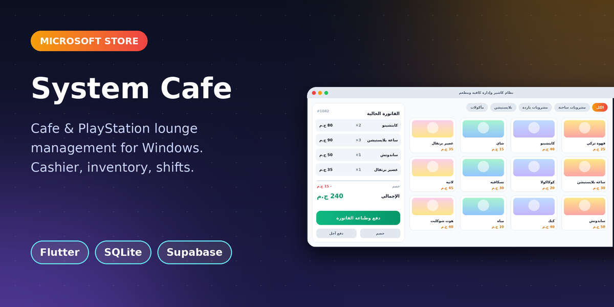

  
  
  

## 👨‍💻 About
I build **production-ready cross-platform apps** from a single Flutter codebase: UI, API integration, licensing systems and store publishing.

- 🖥️ Windows desktop software on the **Microsoft Store** (MSIX)
- 📱 Android apps on **Google Play**
- 🔐 Device-fingerprint licensing with trial & remote activation
- 🌍 Arabic / RTL interfaces, dark & light themes

## 🧰 Tech Stack

  

## 🚀 Featured Work
<table>
  <tr>
    <td width="50%"></td>
    <td width="50%"></td>
  </tr>
  <tr>
    <td width="50%"></td>
    <td width="50%"></td>
  </tr>
  <tr>
    <td width="50%"></td>
    <td width="50%" align="center"> <b>More on the way…</b> Click any card to open the live app. Client projects are private. <a href="https://github.com/waledmabrok/Final-project-main">EClinic source on GitHub</a></td>
  </tr>
</table>

## 📫 Let's Work Together
📍 Zagazig, Egypt · Open for freelance Flutter projects · 📧 waled.ahmed.business@gmail.com
