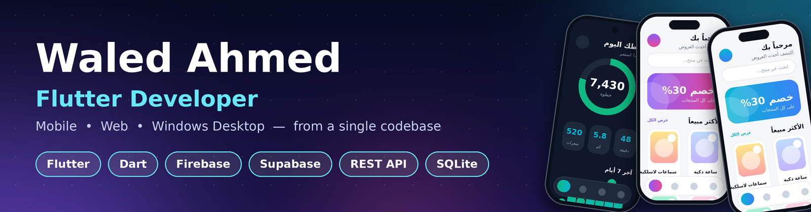

---

## 👨‍💻 About
I build **production-ready cross-platform apps** from a single Flutter codebase: UI, backend/API integration, licensing systems and store publishing.

- 🖥️ **Windows desktop software** published on the **Microsoft Store** (MSIX)
- 📱 **Android apps** published on **Google Play**
- 🔐 Device-fingerprint licensing with trial & remote activation
- 🌍 Arabic / RTL interfaces, dark & light themes

## 🧰 Tech Stack

  

## 🚀 Featured Work

### 🖥️ System Cafe — Cafe & PlayStation Management  `Microsoft Store`
Cashier & billing · staff shifts with automatic salary calculation · gram-level inventory with recipe-based deduction · customer credit accounts · device-locked licensing.
**Flutter · SQLite · Supabase**

### 🏢 ISP Management System  `Mobile · Web · Windows`
Three role-based interfaces (Admin / Sales / Warehouse) from **one codebase**, integrated with a PHP REST API.
**Flutter · REST API**

### 🍽️ Restaurant Management  `Google Play`
Admin, Cashier, Chef & Customer apps with real-time order flow.
**Flutter · REST API**

### 👥 HR Management  `Google Play`
QR-code attendance, notifications, admin controls, dark/light theme.
**Flutter · Firebase / SQLite**

### 🏠 Home Services App  `Google Play`
Provider listing, booking, wallet, scheduling & real-time updates.
**Flutter · REST API**

> 📸 **Screenshots:** *(add real screenshots here — see the `Screenshots` note below)*

## 📊 GitHub Stats

  
  

## 📫 Let's Work Together

  
  

📍 Zagazig, Egypt · Open for freelance Flutter projects
