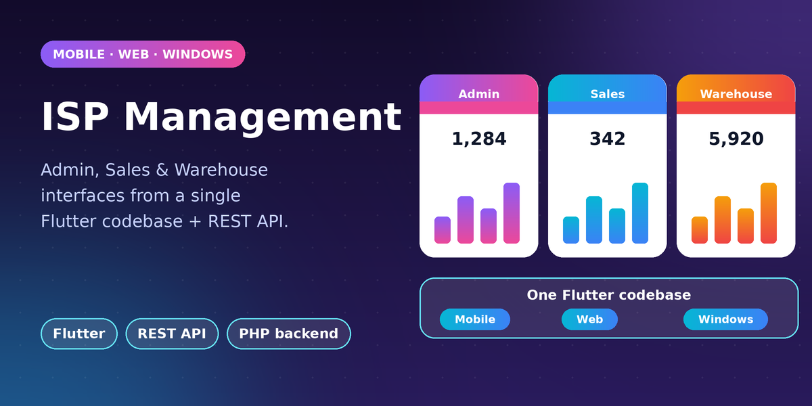
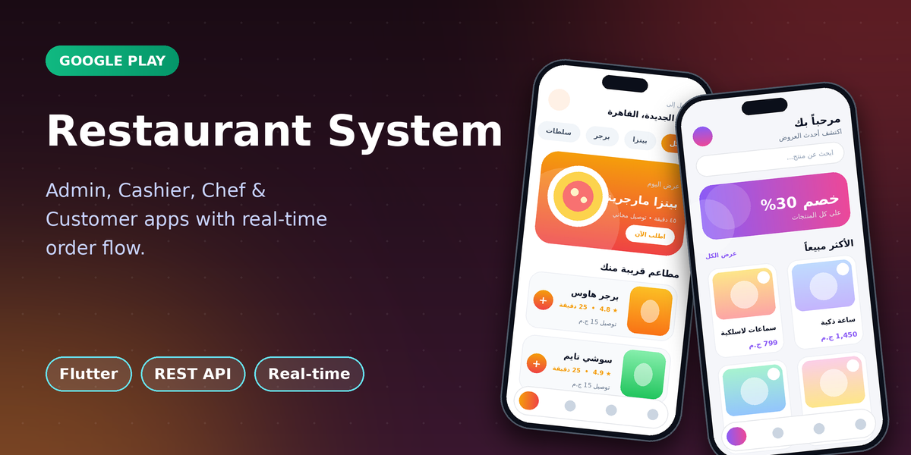
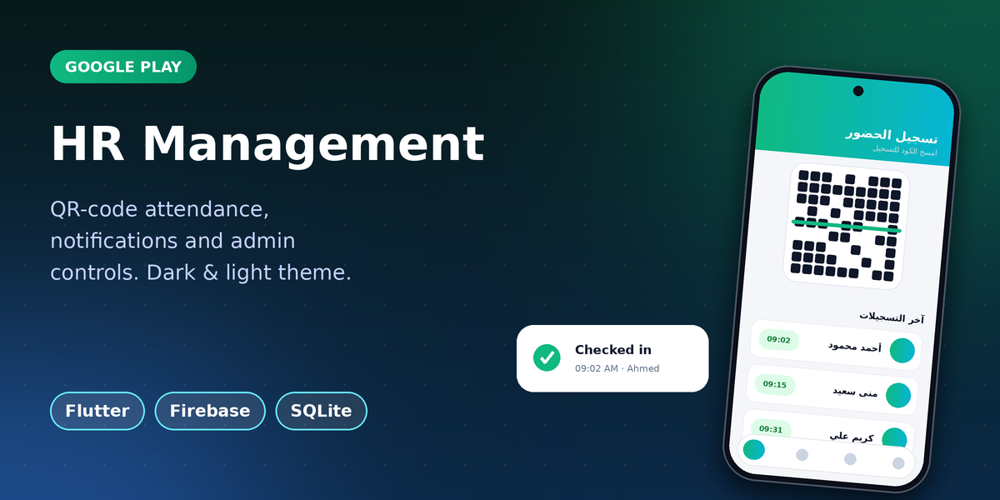
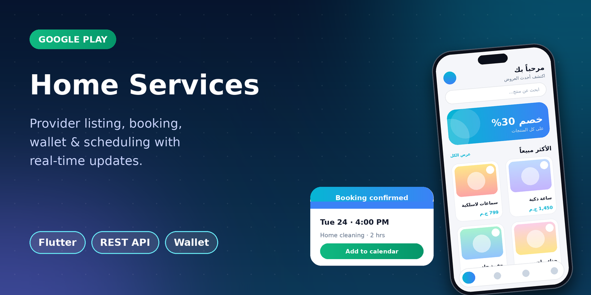

  
  
  

## 👋 About Me

I'm **Waled Ahmed**, a Flutter developer based in **Zagazig, Egypt**, with a bachelor's degree in Computer and Information Technology from Zagazig University (2024).

I build **complete, production-grade applications**, not just screens. A single Flutter codebase can become an Android app, a web app and a Windows desktop program. I take projects all the way: understanding the client's business, designing the UI, connecting the backend or database, protecting the product with licensing, and **publishing it on Google Play and the Microsoft Store**.

I started my career at **YourColor Company** (2024–2025), working on production mobile apps alongside backend teams. Since 2025 I've been freelancing full-time, delivering Flutter mobile and desktop applications for clients in different industries: cafes and gaming lounges, restaurants, ISPs, HR, home services and healthcare.

What I care about most is **software that real businesses can run every day**: fast to use, reliable, and easy for non-technical people to operate.

## 🧭 What I Can Build For You

| | |
|---|---|
| 🖥️ **Windows desktop software** | POS / cashier systems, inventory, billing, reports, packaged as MSIX and published on the Microsoft Store |
| 📱 **Android apps** | Booking apps, delivery & restaurant apps, HR & attendance apps, service marketplaces |
| 🌐 **Web dashboards** | Admin panels and role-based systems from the same Flutter codebase |
| 🔌 **Backend integration** | REST APIs, Firebase, Supabase, local databases and local servers |
| 🔐 **Licensing & activation** | Device-locked activation, trial periods and remote activation |
| 🧾 **Documents & reports** | PDF generation, invoice printing and QR-code features |
| 🌍 **Arabic-first interfaces** | Full RTL support, dark & light themes |
| 🚀 **Store publishing** | Google Play Console and Microsoft Partner Center, from build to release |

## 💼 Experience

**Freelance Flutter Developer** · *2025 – Present*
- Build Flutter mobile and desktop applications for clients across multiple industries
- Deliver full solutions: UI, backend/API integration, database design, licensing systems and app publishing
- Manage client requirements, ongoing updates and post-launch support

**Flutter Developer · YourColor Company, Egypt** · *2024 – 2025*
- Worked on production mobile applications in collaboration with backend teams
- Delivered a **Home Services app** (provider listing, booking, scheduling, real-time updates; published on Google Play)
- Built an **HR Management system** with QR-code attendance, notifications and admin controls (Flutter, Firebase)
- Contributed UI components and features to **FixIt**, a home-maintenance booking app

## 🚀 Featured Work
<table>
  <tr>
    <td width="50%"></td>
    <td width="50%"></td>
  </tr>
  <tr>
    <td width="50%"></td>
    <td width="50%"></td>
  </tr>
  <tr>
    <td width="50%"></td>
    <td width="50%" align="center"> <b>More on the way…</b> Click any card to open the live app. Client projects are private. <a href="https://github.com/waledmabrok/Final-project-main">EClinic source on GitHub</a></td>
  </tr>
</table>

### 🔎 A closer look

**🖥️ System Cafe: Cafe & PlayStation Management** *(Microsoft Store)*
A full desktop system for cafes and gaming lounges: cashier and billing for consoles, drinks and products with real-time order tracking; staff shifts with check-in/out and automatic salary calculation; **gram-level inventory** with recipe-based stock deduction; customer accounts with deferred payments, discounts and expense tracking; and a **device-locked licensing system** with trial period and remote activation through Supabase.

**🏢 ISP Management System** *(Mobile · Web · Windows)*
One Flutter codebase delivering three role-based interfaces. **Admin**: invoices, order approval, customers, sales tracking, inventory and permissions. **Sales**: order creation and per-agent customer management. **Warehouse**: stock-in, per-product analytics, goods-receipt notes and order collection. Integrated with a PHP REST API built by a backend teammate.

**🍽️ Restaurant Management** *(Google Play)*
Four roles in one system (Admin, Cashier, Chef, Customer) with product management and a real-time order flow between customers, cashiers and the kitchen.

**👥 HR Management** *(Google Play)*
Employee management with QR-code attendance, notifications and light/dark themes.

**🏠 Home Services App** *(Google Play)*
Service-provider listing, booking, wallet, scheduling and real-time updates.

**🩺 EClinic**
Doctor booking and video consultation platform.

## 🧰 Technical Skills

| Area | Tools |
|---|---|
| **Languages** | Dart, C++ |
| **Framework** | Flutter (Android, Web, Windows Desktop) |
| **State management** | Provider |
| **Data & storage** | Supabase, Firebase, Firestore, SQLite, Hive, Shared Preferences, SQL |
| **APIs & services** | REST APIs, authentication, push notifications, local/embedded servers (Shelf) |
| **Licensing & security** | Device-fingerprint activation, hardware-locked licensing, trial management |
| **Desktop deployment** | MSIX packaging, Windows native APIs (Win32 / FFI), Microsoft Partner Center |
| **Documents** | PDF generation, printing, QR codes |
| **UI / UX** | Custom widgets, animations, dark/light theming, Arabic RTL |
| **Engineering** | OOP, SOLID principles, design patterns |
| **Tools** | Git, GitHub, Google Play Console, Microsoft Partner Center |

  

## 🤝 How I Work

1. **Understand the business**: I turn your day-to-day needs into clear features, not just a list of screens.
2. **Design & build**: clean UI first, then the logic, database and integrations.
3. **Test in real conditions**: I debug issues the way they appear in the real world, including deployment problems.
4. **Publish**: store setup, packaging and release.
5. **Support**: updates and post-launch support when you need them.

I keep the code organized and well commented so it stays maintainable for the client's long-term use.

## 🌐 Languages
- 🇪🇬 Arabic: native
- 🇬🇧 English: intermediate
- 🇩🇪 German: A2

## 🇪🇬 نبذة بالعربي

أنا **وليد أحمد**، مطور Flutter من الزقازيق، خريج كلية الحاسبات والمعلومات (جامعة الزقازيق 2024). بعمل تطبيقات كاملة بتشتغل على **أندرويد وويب وويندوز** من كود واحد، من تصميم الواجهة والربط بالـ API وقواعد البيانات، لحد نظام الترخيص والنشر على **Google Play وMicrosoft Store**.

اشتغلت في شركة YourColor على تطبيقات حقيقية، وبشتغل حالياً فريلانسر على أنظمة للكافيهات والمطاعم والموارد البشرية والخدمات المنزلية وشركات الإنترنت.
لو عندك فكرة أو نظام محتاج تنفذه، كلمني.

## 📫 Let's Work Together

I'm open to freelance Flutter projects: desktop systems, mobile apps and dashboards.

- 💼 [LinkedIn](https://www.linkedin.com/in/waled-mabrok-80605b35b)
- 📧 waled.ahmed.business@gmail.com
- 📍 Zagazig, Egypt
